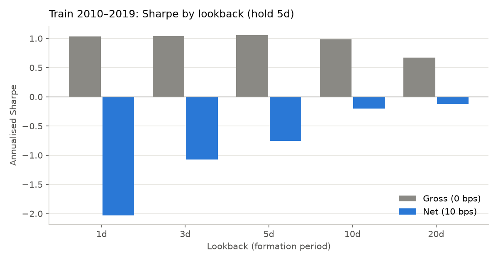
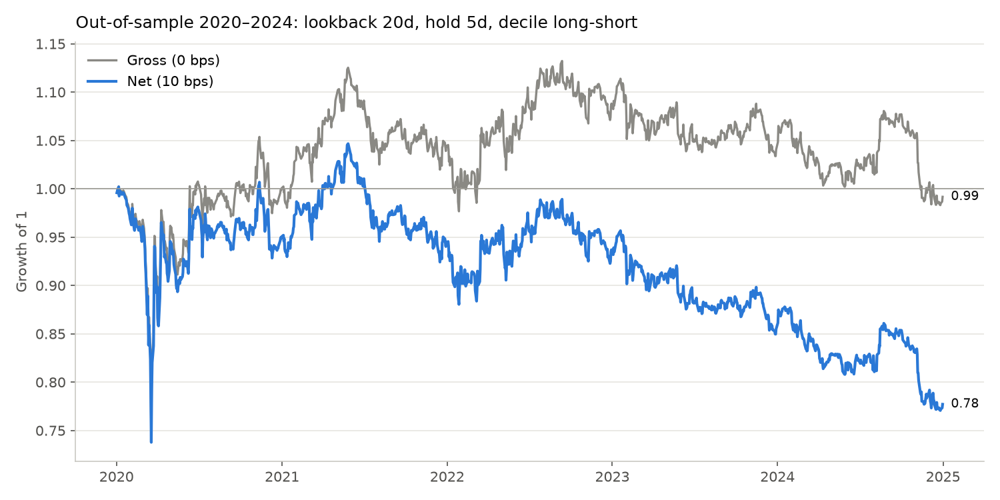
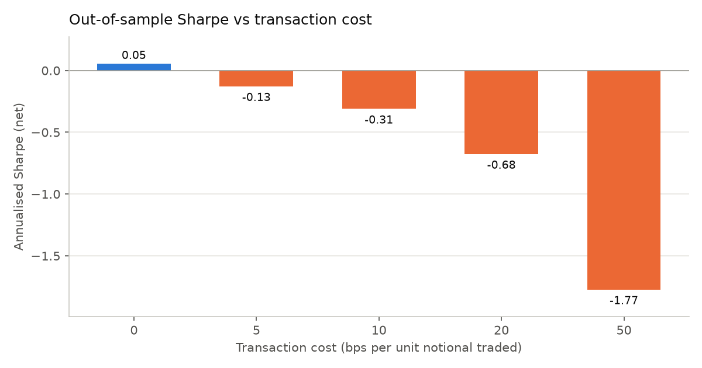
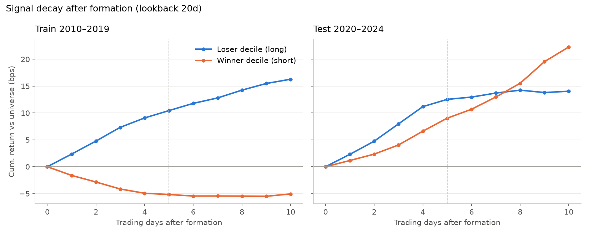

# Financial Signal Research: Short-Term Mean Reversion in S&P 500 Equities

A complete, reproducible test of the short-term reversal effect in US large caps. It includes a look-ahead-safe backtest, transaction costs, a time-based train/test split with a frozen parameter choice, and an out-of-sample evaluation that was run once.

**Headline finding (negative result).** Over 2010–2019 the reversal effect is real before costs: a decile long-short book earns a gross Sharpe of about 1.0 (Newey-West t ≈ 3.5). But the strategy trades about 35–90× its capital per year, so at 10 bps per trade every variant loses money. Out of sample (2020–2024), the frozen strategy has a gross Sharpe of **0.05** (t = 0.12, no detectable effect) and a net Sharpe of **−0.31** at 10 bps. Its break-even cost is **≈1.5 bps**. The effect weakened after 2019, and it was never strong enough to pay for its own turnover at realistic costs.

---

## Hypothesis

Stocks with extreme negative recent returns (bottom decile) outperform stocks with extreme positive recent returns (top decile) over the next 5 trading days. The economic story is overreaction plus liquidity provision. Price pressure from news or order flow pushes prices past fair value, and the move partially reverses (Jegadeesh 1990; Lehmann 1990; Lo & MacKinlay 1990).

## Data

| Item | Value |
|---|---|
| Source | Yahoo Finance daily bars via `yfinance` (`auto_adjust=True`: splits and dividends folded into the close) |
| Universe | 503 current S&P 500 constituents scraped from Wikipedia on 2026-10-19 → [`data/sp500_tickers.csv`](data/sp500_tickers.csv) |
| Tickers with price data | 498. FDXF, HONA, Q, SNDK and VYLR returned no data for 2009–2024 (recent listings or spin-offs) |
| Downloaded period | 2009-11-02 to 2024-12-31. Nov–Dec 2009 is warm-up only, so lookbacks are live on the first evaluation day |
| Trading days | 3,816 |
| Stock-day price observations | **1,779,302** (median 472 stocks per day, minimum 415) |
| Data checks | 13 daily moves with \|return\| > 50% (max +74.6%, min −53.9%). Kept: they look like real events, and removing them would be a judgement call made with hindsight |

Survivorship bias: the universe is *today's* index members projected back to 2010. Firms that were delisted, acquired or dropped from the index are missing, and firms that were added later are included before they joined. See [Limitations](#limitations).

## Methodology

Full detail, including every design decision and why, is in [`docs/METHODOLOGY.md`](docs/METHODOLOGY.md).

1. **Signal.** At each close *t*, compute every stock's past *L*-day return, `P_t / P_{t−L} − 1`, and rank stocks cross-sectionally. Go long the bottom 10% (losers) and short the top 10% (winners). Days with fewer than 50 valid stocks are skipped (this never happened in the sample).
2. **Weights.** The book is dollar-neutral. Weights are equal within each leg: the long leg sums to +0.5 and the short leg to −0.5, so gross exposure is 1 and net exposure is 0.
3. **5-day holding period.** The book is built from overlapping portfolios (Jegadeesh-Titman). Capital is split into 5 tranches, and each day one tranche is re-formed and held for 5 days. The live book is the average of the last 5 daily target books.
4. **Timing (no look-ahead).** Weights decided at the close of *t* earn the close-to-close return of *t+1*: `pnl_t = Σ w_{t−1} · r_t`. This is unit-tested.
5. **Costs.** A fixed cost in bps is charged on every unit of notional traded, on each side. Traded notional is drift-aware: `Σ |w_t − w_{t−1}(1 + r_t)|`. A full flip from +w to −w costs twice as much as opening.
6. **Train/test split by time.** Train covers 2010–2019 and is used only to choose the lookback *L* ∈ {1, 3, 5, 10, 20}. Test covers 2020–2024. The train stage truncates the price panel at 2019-12-31 *before* computing anything. It writes its choice to [`results/selection.json`](results/selection.json), and the test stage only reads that file.
7. **Embargo.** The last 5 trading days of 2019 are left out of the train evaluation window (it ends on 2019-12-23).
8. **Fixed in advance, not tuned:** holding period = 5 days, decile cut-off = 10%, base cost = 10 bps, and the selection rule (highest train Sharpe net of 10 bps).
9. **Metrics.** Annualised return (arithmetic) and CAGR, volatility, Sharpe (risk-free rate = 0; the book is dollar-neutral), Newey-West t-statistic with 5 lags, maximum drawdown, hit rate, daily turnover, annual cost drag and break-even cost.

## Results

### Train 2010–2019: lookback selection (hold 5 days, 10 bps)

| Lookback | Gross Sharpe | Gross ann. return | NW t (gross) | **Net Sharpe** | Net ann. return | Net max DD | Daily turnover |
|---:|---:|---:|---:|---:|---:|---:|---:|
| 1 | 1.03 | 2.97% | 3.52 | −2.03 | −5.83% | −44.7% | 34.9% |
| 3 | 1.04 | 4.35% | 3.45 | −1.08 | −4.50% | −39.2% | 35.1% |
| 5 | 1.06 | 5.18% | 3.45 | −0.75 | −3.68% | −35.8% | 35.2% |
| 10 | 0.98 | 5.44% | 3.21 | −0.20 | −1.10% | −20.1% | 25.9% |
| **20** | 0.67 | 4.03% | 2.18 | **−0.13** | −0.76% | −22.3% | 19.0% |

**Selected lookback: 20 days.** It was chosen by the pre-set rule and is only the *least negative* net Sharpe. Lookbacks of 1–10 days have the strongest gross effect but lose the most after costs because of their turnover. The hypothesis named 5 days. The rule picked 20, and the rule was not overridden after seeing this.



### Out-of-sample 2020–2024 (lookback 20, hold 5, evaluated once)

| Metric | Gross (0 bps) | Net (10 bps) |
|---|---:|---:|
| Sharpe | 0.05 | −0.31 |
| Newey-West t-stat (p-value) | 0.12 (0.91) | −0.68 (0.50) |
| Annualised return (arithmetic) | 0.72% | −4.16% |
| CAGR | −0.17% | −4.93% |
| Annualised volatility | 13.38% | 13.37% |
| Max drawdown | −25.64% | −26.37% |
| Hit rate (positive days) | 47.0% | 45.8% |
| Total return over 5 years | −0.83% | −22.29% |
| Avg daily turnover (notional / capital) | 19.4% | 19.4% |
| Annual cost drag | — | 4.88% |
| Break-even cost | **1.48 bps** | |



### Cost sensitivity (out-of-sample, net)

| Cost (bps) | Sharpe | Ann. return | Max DD | NW t |
|---:|---:|---:|---:|---:|
| 0 | 0.05 | 0.72% | −25.6% | 0.12 |
| 5 | −0.13 | −1.72% | −26.0% | −0.28 |
| 10 | −0.31 | −4.16% | −26.4% | −0.68 |
| 20 | −0.68 | −9.05% | −39.7% | −1.47 |
| 50 | −1.77 | −23.70% | −70.9% | −3.86 |



### Calendar years (out-of-sample)

| Year | Gross | Net (10 bps) |
|---|---:|---:|
| 2020 | +0.05% | −4.96% |
| 2021 | +4.29% | −0.69% |
| 2022 | +4.29% | −0.73% |
| 2023 | −4.39% | −8.75% |
| 2024 | −4.68% | −9.11% |

### Signal decay (diagnostic, lookback 20)

This shows the average market-adjusted cumulative return of each decile after formation. It is a diagnostic that uses future prices by design, and it was never used for selection.

| | Losers, day 5 | Winners, day 5 | Spread, day 5 | Spread, day 10 |
|---|---:|---:|---:|---:|
| Train 2010–2019 | +10.4 bps | −5.2 bps | +15.6 bps | +21.3 bps |
| Test 2020–2024 | +12.5 bps | +9.0 bps | +3.5 bps | −8.2 bps |



### Interpretation

Before 2020, short-term reversal exists in this universe and is statistically strong before costs (t ≈ 3.5 at 1–5 day lookbacks). It is not economically exploitable at 10 bps. Each 5-day reversal is only a few bps per name, and harvesting it means turning over roughly a third of the book every day. In the train period, 10 bps of cost wipes out every variant. Out of sample the gross edge itself mostly disappears. In the test period the losers still bounce, but the winners no longer give back their gains: they keep outperforming, which is consistent with momentum taking over (2023–24 were dominated by persistent mega-cap winners). The spread turns negative after about 7 days. Net of costs the strategy loses about 4% a year, and it would need all-in costs below about 1.5 bps to break even. **Conclusion: a real but small anomaly whose profits go to whoever can trade it most cheaply (market makers and liquidity providers). A daily-close strategy paying retail-to-institutional costs cannot capture it.**

## Limitations

- **Survivorship and look-ahead in the universe.** Using today's constituents excludes firms that failed or left the index and includes firms before they were added. The direction of the bias for a reversal strategy is ambiguous: losers that later died are missing from the long leg, which flatters it.
- **Close-to-close execution.** The backtest assumes trading exactly at the close at the closing price. Real execution adds slippage, and part of measured short-term reversal is known to come from bid-ask bounce in closing prices.
- **Costs are a flat bps charge.** There is no spread model, no market impact, and no short-borrow fees or locate constraints. All three would make results worse.
- **Daily rebalancing to equal weights** within each tranche is assumed. Its drift cost is included in turnover.
- **Single universe and period.** US large caps, 2010–2024. Small caps, where reversal is stronger and costs are higher, are not tested.
- **Selection is a max over 5 candidates.** That is a small search, but the chosen train Sharpe is still optimistically biased. It is negative anyway.
- **Data revisions.** Yahoo's adjusted history changes as new dividends and splits are applied, so re-downloading can give slightly different numbers. The SHA-256 hashes of the exact data used are in [`results/data_summary.json`](results/data_summary.json).

## Reproducibility

```bash
python -m venv .venv
.venv/Scripts/activate        # Windows; use `source .venv/bin/activate` on macOS/Linux
pip install -r requirements.txt
pytest -q                     # 7 correctness tests (look-ahead, lag, costs, drift, deciles)
python run_research.py        # data -> train -> test; or --stage data|train|test
```

There is no randomness anywhere in the pipeline. The universe CSV is committed. Prices are cached to `data/sp500_prices.parquet`, which is not committed (Yahoo data is not redistributed). Delete it to re-download. A run of the test stage regenerates every number and figure in this README from `results/`.

## Repository layout

| Path | Contents |
|---|---|
| `run_research.py` | Pipeline and configuration (dates, lookbacks, costs) |
| `src/data.py` | Universe scrape, chunked Yahoo download with retry, gap cleaning, data summary |
| `src/signals.py` | Past returns, decile ranks, dollar-neutral weights, overlapping 5-day holdings |
| `src/backtest.py` | Lagged P&L, drift-aware turnover, costs |
| `src/metrics.py` | Sharpe, Newey-West t-stat, drawdown, hit rate, yearly returns |
| `src/analysis.py` | Signal-decay event study |
| `tests/` | Unit tests for look-ahead, lag, cost and weighting logic |
| `results/` | Every number in this README as CSV/JSON, plus `selection.json` (frozen train choice) |
| `figures/` | Equity curve, signal decay, cost sensitivity, train lookback chart |
| `docs/METHODOLOGY.md` | Design decisions, formulas, and corrections to the original build guide |
| `docs/BUILD_LOG.md` | Chronological record of how the project was built and run |
| `docs/BUILD_GUIDE.md` | The original project brief this repo was built from |

## References

- Jegadeesh, N. (1990). Evidence of predictable behavior of security returns. *Journal of Finance*, 45(3).
- Lehmann, B. (1990). Fads, martingales, and market efficiency. *Quarterly Journal of Economics*, 105(1).
- Lo, A. W., & MacKinlay, A. C. (1990). When are contrarian profits due to stock market overreaction? *Review of Financial Studies*, 3(2).
- Jegadeesh, N., & Titman, S. (1993). Returns to buying winners and selling losers. *Journal of Finance*, 48(1). (Overlapping-portfolio construction.)
- Newey, W. K., & West, K. D. (1987). A simple, positive semi-definite, heteroskedasticity and autocorrelation consistent covariance matrix. *Econometrica*, 55(3).
- Bailey, D. H., Borwein, J. M., López de Prado, M., & Zhu, Q. J. (2014). Pseudo-mathematics and financial charlatanism. *Notices of the AMS*, 61(5).
- López de Prado, M. (2018). *Advances in Financial Machine Learning*. Wiley. (Purging and embargo.)
